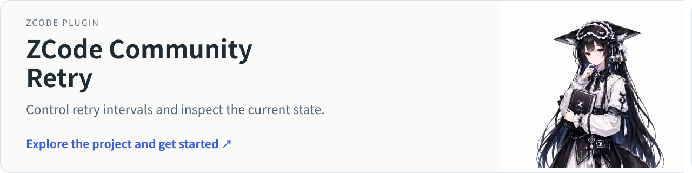
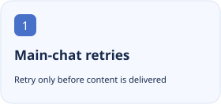

<p align="center"></p>

<h1 align="center">ZCode Community Retry</h1>

<p align="center">Retry supported transient failures in ZCode main chat, with a configurable interval, cancellation and an optional Keeper.</p>

<p align="center"><a href="https://github.com/tangyixiao/zcode-community-retry"></a></p>

<p align="center"><a href="README.md">简体中文</a> · <a href="README.en.md">English</a></p>

[](https://github.com/tangyixiao/zcode-community-retry/stargazers) [](https://github.com/tangyixiao/zcode-community-retry/actions/workflows/test.yml) [](LICENSE)

<p align="center">
  <picture><source media="(prefers-color-scheme: dark)" srcset="docs/assets/feature-1-en-dark.svg"></picture>
  <picture><source media="(prefers-color-scheme: dark)" srcset="docs/assets/feature-2-en-dark.svg"></picture>
  <picture><source media="(prefers-color-scheme: dark)" srcset="docs/assets/feature-3-en-dark.svg"></picture>
</p>

## Get started

```text
https://github.com/tangyixiao/zcode-community-retry
```

Add this repository URL in ZCode Plugin Market, install `zcode-community-retry@tangyixiao-zcode-community`, and enable it in user scope. Start a new chat and inspect `/retry-status` for the current Agent. Keeper is separately optional.

## Status and compatibility

| Item | Current source of truth |
| --- | --- |
| Source version | `0.3.4` · 以 [package.json](package.json) 为准 |
| Distribution | `native` · [Releases](https://github.com/tangyixiao/zcode-community-retry/releases) |
| Node.js | `>=22` |
| Development | [Open issues](https://github.com/tangyixiao/zcode-community-retry/issues?q=is%3Aissue+is%3Aopen) · [CI](https://github.com/tangyixiao/zcode-community-retry/actions) |

Native integration targets Windows ZCode Desktop and npm CLI and depends on internal interfaces. Balance, authentication and lasting permission errors are terminal. With Keeper enabled, disabling Retry alone is reversed; disable Keeper first to revoke that policy.

[Native Retry guide](community/README.md)

## Development and participation

```sh
npm test
node tools/check-repository.mjs
```

[Contributing](CONTRIBUTING.md) · [Support](SUPPORT.md) · [Questions](https://github.com/tangyixiao/zcode-community-retry/discussions) · [Report a bug](https://github.com/tangyixiao/zcode-community-retry/issues/new/choose) · [Security](SECURITY.md) · [Maintenance](docs/maintenance.md)

## Star History

<picture><source media="(prefers-color-scheme: dark)" srcset="https://api.star-history.com/chart?repos=tangyixiao/zcode-community-retry&amp;type=date&amp;theme=dark&amp;legend=top-left"></picture>

[Interactive chart](https://www.star-history.com/?repos=tangyixiao%2Fzcode-community-retry&type=date) · [GitHub Stars](https://github.com/tangyixiao/zcode-community-retry/stargazers)

The external chart uses real star records and may be cached or unavailable; no development percentage is inferred.

## Origin and licenses

[Software license](LICENSE) · [Logo artwork and attribution](assets/NOTICE.md)
